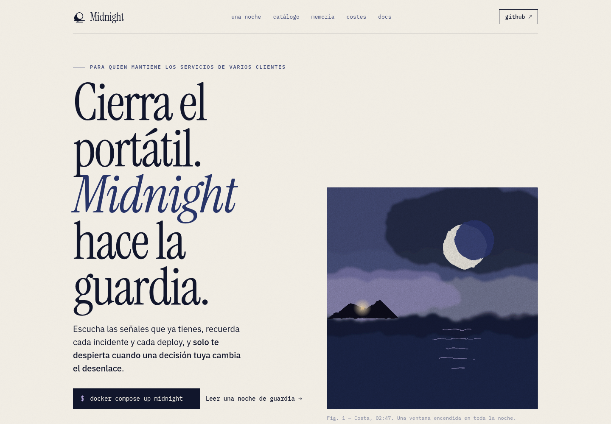
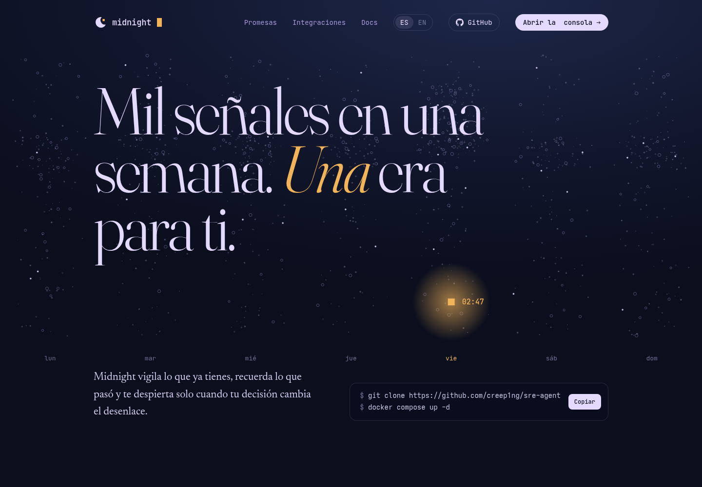
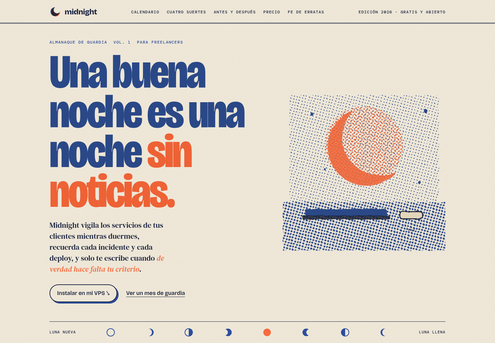
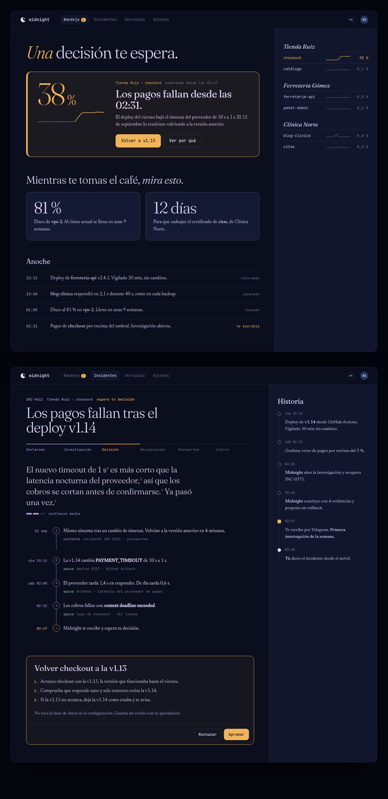
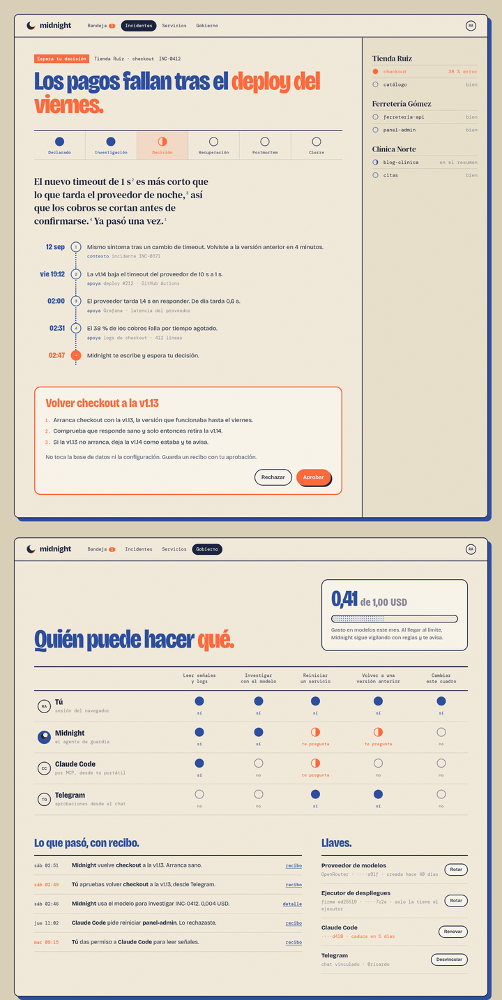

# Brand round 1: what Midnight's landing could look like

Exploration requested by the maintainer on 2026-10-30, after the [vision and values](../../vision.md)
were accepted. Three directions for a public landing, each a self-contained HTML file you can open
in a browser. Nothing here is wired to the product, and nothing changes the console.

Reference given: [boat.dev](https://boat.dev). It mixes a terminal language (prompt with a block
cursor, tmux-style status bar footer, window mockups instead of photos) with a soft nautical
metaphor (a watercolour "wash" logo, "Set sail"). The type stack is Funnel Display, Inter and
IBM Plex Mono on near-black, off-white and one ocean blue (`#263fa9`). The tone is calm and
engineer to engineer, backed by numbers, with "no need to oversell". The three directions keep that
restraint and terminal honesty. None of them copies its type or layout.

## The shared brand platform

These hold in all three directions; only the art direction changes.

**Who we talk to.** A freelancer who keeps several clients' services running on one to three VPS,
with no on-call team. The direction record lists their pains: they are never off call, the client
finds the outage first and blames them, flapping alerts teach them to mute the channel, they will
not hand an agent production keys, and monitoring SaaS keeps getting more expensive.

**The promise, in their words.** *Close the laptop. Midnight keeps the watch.* ("Cierra el
portátil. Midnight hace la guardia.") Every section answers "what does this change in my night or
my morning", not "what does the engine do".

**The metaphor.** The night watch ("la guardia"). It is how sailors split the night, so it bridges
to the boat.dev reference. It also describes the product honestly: someone else keeps watch and
wakes you only when needed.

**How each value shows up on the page:**

| Value | How the landing expresses it |
| --- | --- |
| 1. Silence is the default | Colour discipline: one warm colour (amber or orange) is reserved for the single moment Midnight interrupts a human. Everything else is ink. Few words, much white space, no exclamation marks, no badges. Each direction shows the four fates: ignore, remember, digest, interrupt. |
| 2. What is not in the catalog cannot happen | A catalog card with real operation names (`deployment.rollback`, `deployment.restart`) next to struck-out things that do not exist (`shell`, `docker exec`, credentials in the agent). |
| 3. Every action is accountable | A receipt: operation, approver, signature, idempotency key, one execution, terminal state. |
| 4. Memory has provenance | The 02:47 message and the recall quote always carry their sources (Grafana query, deploy, past incident). |
| 5. The engine is the product | The CTA is `docker compose up`, not "sign up". The wiring diagram in direction 2 shows chat, API, MCP and console as equal clients. |
| 6. We claim only what we measured | Every number is labelled *target*, *measured* (with date) or *illustrative*. Each direction lists the open bugs (#758–#762, #775) as a "what does not hold yet" or errata section. |
| 7. Pocket-sized economics | "< 1 USD per month" is always labelled as a target. The measured 0.002–0.005 USD per investigation from the 2026-10-19 rehearsal appears with its caveat. |

## The three directions

### 1. Bitácora (logbook) — [`01-bitacora.html`](01-bitacora.html)



Paper, ink and a ship's night log. The closest to boat.dev: a terminal command as the CTA, a
tmux-style status bar footer, and a watercolour illustration made with SVG turbulence (a coast at
02:47 with one lit window). The core is the log of one night: six events, one message, one digest.

- Type: Instrument Serif (display), IBM Plex Sans (text), IBM Plex Mono (log).
- Palette: paper `#f3efe6`, ink `#11162c`, sea `#273469` (already in `palette.css`), lamp `#b56a12`
  for interrupts only.
- Mark: a moon setting into a sea line.
- Best for: credibility with developers. It reads like documentation with taste.
- Risk: the quietest of the three. It can feel too literary for some readers.

Full page: [`captures/01-bitacora-full.png`](captures/01-bitacora-full.png)

### 2. Nocturno (night magazine) — [`02-nocturno.html`](02-nocturno.html)



A dark night-time magazine. The hero is generative art: seven nights of simulated signals, each dot
coloured by its fate, and a single amber star on Tuesday at 02:47, "the only time we woke you".
Then a two-column letter to the on-call freelancer, the 02:47 moment set in huge numerals, and the
seven values as chapters, each with "what we rule out" and "how we check", taken from the vision.

- Type: Fraunces (display), Newsreader (text), JetBrains Mono.
- Palette: night `#0a0e1d` to `#1e2749` (the current brand indigo), moonlight `#e4d9ff` (the
  current periwinkle), star `#f2b45a` for interrupts only.
- Mark: a crescent holding one star, the one signal that matters. It evolves the current crescent
  mark instead of replacing it.
- Best for: the most artistic and memorable of the three, and the closest to the current brand.
  The values-as-chapters section could become the public vision page as is.
- Risk: long text on dark backgrounds. On phones the generative sky shows one night and hides the
  star; it needs a vertical composition before it ships.

Full page: [`captures/02-nocturno-full.png`](captures/02-nocturno-full.png)

### 3. Almanaque (almanac) — [`03-almanaque.html`](03-almanaque.html)



A two-ink risograph almanac with halftones, multiply overprint and paper grain. Blue ink is the
night and the system; orange ink is you. A month calendar of moon phases where 28 of 30 nights had
no news, illustrated cards for the four fates, a before-and-after table of the freelancer's week,
a pocket-price coin and a stamped "errata" of the open bugs. Headline: *Una buena noche es una
noche sin noticias* ("A good night is a night with no news").

- Type: Bricolage Grotesque (condensed display), DM Serif Text, DM Mono.
- Palette: paper `#f4eddc`, riso blue `#2d4fa0`, riso orange `#ff6c3e`.
- Mark: an off-register moon whose shadow is the orange ink.
- Best for: warmth and personality, the closest to boot.dev's illustrated, playful side. The
  before-and-after table is the most direct "how we improve your life" section of the three.
- Risk: it moves furthest from the current indigo brand, and riso can read as indie or
  non-serious next to the safety claims.

Full page: [`captures/03-almanaque-full.png`](captures/03-almanaque-full.png)

## Decision and second pass (2026-10-30)

The maintainer picked **Nocturno** and reviewed it with preview annotations. The second pass applies
that review to [`02-nocturno.html`](02-nocturno.html) and extends the same line to the console in
[`04-consola.html`](04-consola.html).

Rule from the review: *cut taglines, helper text and secondary labels; if a screen needs them to make
sense, fix the layout.* Every change must improve the experience of users (UX), developers (DX)
and agents (AX) without breaking anything.

| Review note | Change |
| --- | --- |
| The logo is good but lacks a tech touch | The round star became one amber square pixel, and the wordmark is lowercase JetBrains Mono with a blinking block cursor. The crescent stays organic and the signal is digital. |
| Issue line, "Carta", "Siete promesas" and "Cómo encaja" labels are sloppy | Removed. Headings carry each section, and the left label column is gone. |
| The star should be on Friday, after the deploy-Friday habit | The star is on Friday night, the densest column, and the message cites "the Friday 19:12 deploy". |
| Sign as a real person | The letter is in the first person and signed "— Ricardo". |
| Message card and its header tagline are sloppy; "1 s" breaks across lines | The card is shaped like the real Telegram message: avatar, name, time, numbered source notes and an inline keyboard. It is wider, and units use non-breaking spaces. |
| The centre diagram explains nothing | Drawn as a real flow: four inputs into Midnight, four clients out, and only the Telegram line in amber. No sub-labels. |
| The GitHub link needs the icon | The GitHub mark is in the nav and the closing CTA. |
| Hero helper legend | Removed. The honesty note moved to the footer. |

DX: the hero and the closing section show the real install command (`git clone` plus
`docker compose up -d`) with a copy button. AX: the page declares a `text/markdown` alternate for
`/llms.txt` and SoftwareApplication JSON-LD with the repository, so agents can find a machine-readable
description. `/llms.txt` does not exist yet.


Phone: [`captures/02-nocturno-mobile.png`](captures/02-nocturno-mobile.png). On narrow screens the
sky frames Friday night alone.

### The console in the same line

[`04-consola.html`](04-consola.html) mocks the two main views of `web/incident-console` with the
landing's tokens. It keeps the real vocabulary: the lifecycle phases from `lib/status.ts`, the
evidence verdicts, and the `deployment.rollback` operation.

- **Inbox.** The headline is the state ("One decision is waiting for you"). Below it are the single
  amber decision with its signal chart, last night's log with each event's fate, client services
  with sparklines, and the morning digest.
- **Incident.** The hypothesis is set as prose, with superscript notes tied to numbered evidence.
  Each evidence line shows its source and verdict, which serves the provenance value. The proposed
  catalog operation appears as code next to Approve and Reject, and a story rail lists every actor.



Third pass, after a second review of the console:

| Review note | Change |
| --- | --- |
| The decision can distract or not draw enough attention | The decision leads with the 38 % in large amber type, a heavy amber rule and a simpler sparkline. The actions say what they do ("Volver a v1.13", "Ver por qué"). |
| The digest goes unnoticed; title it "while you have your coffee" | Moved under the decision as "Mientras te tomas el café, mira esto", with two cards, each led by its number. |
| The evidence is not clearly a timeline | The evidence runs in chronological order on a connected timeline with timestamps, a dashed gap for the September precedent, and an amber end at "02:47 Midnight te escribe". The hypothesis notes point to these steps. |
| Turn the operation into something the user understands, not internal code | "Volver checkout a la v1.13" with three plain steps that follow the executor's real behaviour: start the new version, check health, keep the old one if it fails. `deployment.rollback(...)` remains only as the element's tooltip for developers. |

Not covered yet: the console mockup is desktop only, and it has no light theme.

### Almanaque applied to the console — [`05-almanaque-consola.html`](05-almanaque-consola.html)

An exploration of the same two concerns in the Almanaque line, requested on 2026-10-31: incident
attention and governance. The moon phase is the single recurring glyph. It shows lifecycle
progress (full means done, half means now) and permission levels (full means yes, half means it
asks you, empty means no).

- **Incident attention.** The incident has the same content as the Nocturno console: phases as moons,
  an ephemeris-style evidence timeline, and the plain-language rollback plan in orange.
- **Governance for one freelancer.** It reframes principals, resources and grants as one question:
  *who can do what*. Rows are you, Midnight, Claude Code over MCP and Telegram; columns are actions
  a freelancer recognises. Each cell spells its level in words, so no legend is needed. The month's
  model spend appears against the limit, with what happens when the limit is reached. The audit log
  reads as sentences with a receipt link, and the keys show last four characters, age and expiry
  with one action each.



## What is invented in these mockups

These are design explorations, not product evidence. The clients (Tienda Ruiz, ferreteria-api,
blog-clinica), the night's events, the week of signals and the November calendar are illustrative.
Each page labels them that way. `logs.read` in the Bitácora catalog card is not an executor
operation today; only `deployment.rollback` and `deployment.restart` exist. The Telegram flow is the
M1 target (#766, #767), not shipped behaviour. In the console mockups, the clients, the spend, the keys, the permission matrix, INC-0412, INC-0371, the evidence and the
sparklines are invented too. The copy is in Spanish; the English version is decided (see Decisions) but not written in these mockups. The console's language switch only translates its chrome.

## Decisions (2026-10-31)

1. **Brand base:** Nocturno (2026-10-30).
2. **Name:** the product is **Midnight**, without `.agent`. The wordmark is the lowercase `midnight`.
3. **Language:** the landing and the console ship in Spanish and English. The landing has an `ES · EN` switch in its navigation; in the console the language lives in the account menu.
4. **Amber is a product rule:** the one warm colour appears only where a human decision is needed, in the console and in chat messages. Entry points such as "Abrir la consola" use moonlight, never amber.
5. **Console:** Nocturno, not Almanaque. `06-consola-dia-noche.html` is the reference; `04` and `05` stay as history.
6. **Theme:** follows the OS by default; the account menu offers System, Light and Dark.
7. **Account menu:** the avatar opens a popover with language, theme and sign out.
8. **Entry:** the web server's `/` serves the landing; its "Abrir la consola" button opens the incident console.
9. **Release candidates:** the console already built under `/app` (issues #703, #704, #708 and their stacks) is **RC-1**. This design is **RC-2**. Neither is final, and the RC-1 artefacts are preserved, not overwritten.

## How these were rendered

```sh
chromium --headless=new --hide-scrollbars --window-size=1440,<page height> \
  --virtual-time-budget=10000 --screenshot=out.png file://$PWD/01-bitacora.html
```

Fonts load from Google Fonts. Without network the pages fall back to Georgia and system fonts.

## Nocturno by day (light mode) and the fourth pass

`06-consola-dia-noche.html` supersedes `04-consola.html`: the inbox and the incident-attention screen, each in night and day.
Every colour is a token scoped to `.frame`; the day theme is `.frame.day` overriding tokens only, with identical markup.
In the product the theme follows the OS (`prefers-color-scheme`).

- Day keeps the night grammar: cool lavender paper (`#f7f5fb`), navy ink (`#141a33`), a deeper mist (`#6650b0`) for secondary text.
- Amber is still the only warm colour and still means "a human is needed". On paper it splits: `--star` (`#f2b45a`) fills buttons and marks, `--star-ink` (`#a65a00`) colours text, `--star-edge` (`#d48a2a`) draws borders.
- The crescent in the logo turns navy; the amber pixel does not change.

| Review note | Change |
| --- | --- |
| Evidence numbers should be underlined and explain themselves | Each claim in the hypothesis is underlined; hover or focus opens a card with the verdict, time, sentence, source and a link to it. Clicking the claim jumps to its step in the timeline. |
| Code references should look like code | `PAYMENT_TIMEOUT` and `context deadline exceeded` are `code`: mono on a slightly different background. |
| Navigation should not be mono and should have icons | Nav uses Newsreader with an icon per section (inbox, siren, server, sliders). The wordmark stays mono. |
| The side panel should be collapsible | Both side panels fold to a 64px rail that keeps the dots (the amber one included); the choice is remembered per screen. |
| Theme | Follows the OS. |

Capture: `captures/06-consola-dia-noche-full.png` (the `#open` hash shows one evidence card as if hovered).
