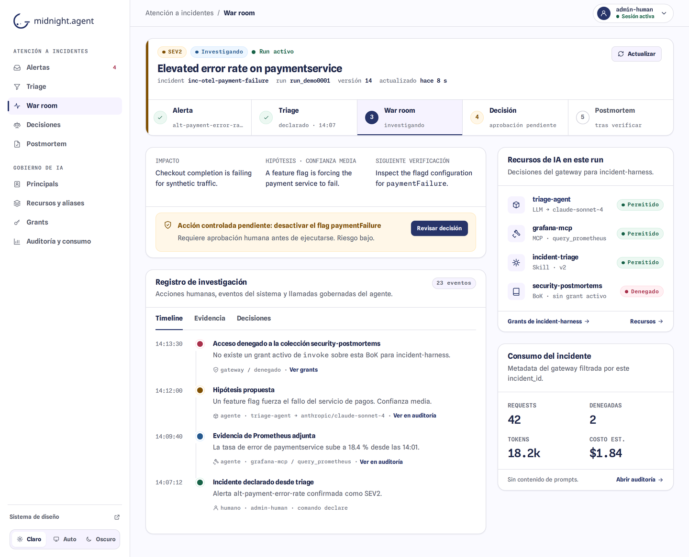
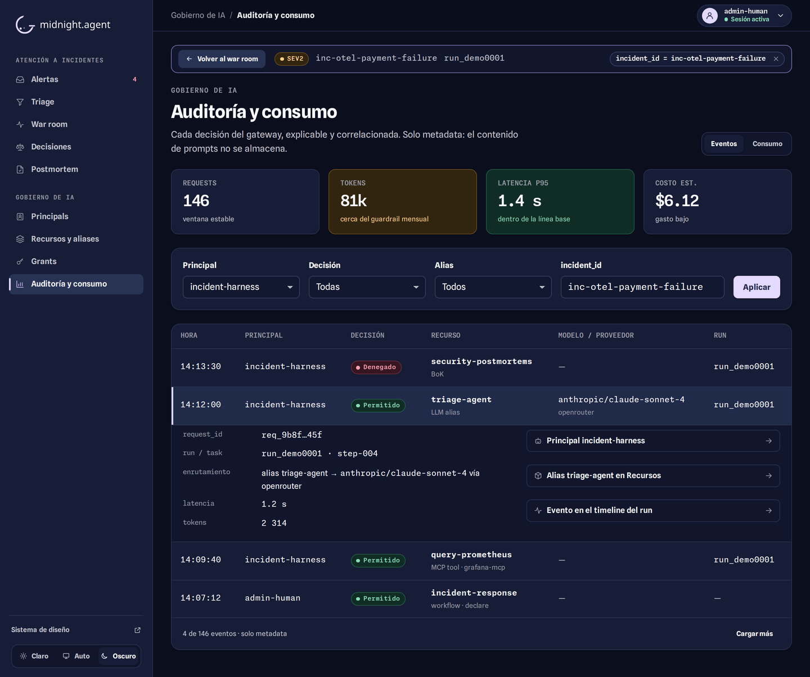
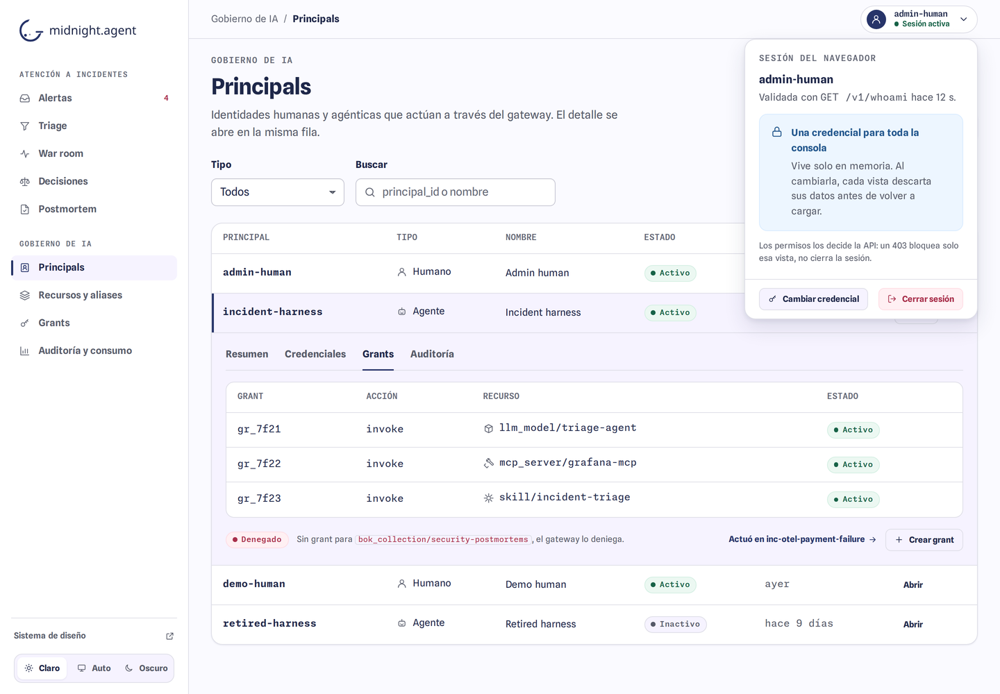

# HT-WEB-SHELL — Integrated console

- Issue: [#487](https://github.com/creep1ng/sre-agent/issues/487)
- Status: design approved by the maintainer on 2026-10-15; delivered as a stack of pull requests.
- Session dependency: [#486](https://github.com/creep1ng/sre-agent/issues/486), ADR-009 (open PRs #583–#643).

## Problem found in the audit

The web surfaces were ten separate pages under `public/admin/` and `public/incident-ui/`:

- Three different headers and three navigation sets; Review and Postmortem had neither, Triage was
  reachable only from the inbox, and `/` served the design-system catalog.
- Nine pages each kept their own credential store, so the API key was asked again on every page
  and lost on every link, including Triage → War room and "View correlated events".
- The journey broke after the war room: Review and Postmortem were orphaned, consumption and audit
  events did not link to each other, and no screen connected an incident to the governed AI
  resources it used, although audit and consumption already filter by `incident_id`.
- Governance screens were in English, incident screens in Spanish, and the theme used three
  mechanisms (`ma-theme`, `midnight-agent-theme`, none).
- Under the nginx CSP (`default-src 'self'`) the brand fonts and the inline theme scripts never
  load. Spline Sans also ships a 0.19 em word space, so bold labels read as one word, including in
  the catalog ("Prometheusevidenceattached").

## Decisions

| Topic | Decision |
| --- | --- |
| Entry | One document at `/`: the console. The catalog moves to the documentary route `/design-system.html`. |
| Navigation | One sidebar with two groups of the same product: *Atención a incidentes* (Alertas, Triage, War room, Decisiones, Postmortem) and *Gobierno de IA* (Principals, Recursos y aliases, Grants, Auditoría y consumo). There is no plane selector; every destination applies its own 403. |
| Routes | `/?view=<id>&<read parameters>` with the History API. Reload, deep links and Back/Forward work with the existing nginx `try_files`; parameters only select reads (ADR-009, section 12). |
| Old addresses | Every surface that moves into the console keeps its page as markup plus a redirect to its view, preserving read parameters. |
| Session | One session per tab with the ADR-009 interface (`state`, `subscribe`, `setCredential`, `logout`, `retry`), validated by `GET /v1/whoami`. A 401 of the current generation ends it for every view; a 403 affects only the view that received it. The SharedWorker of #486 replaces `public/console/session.js` without touching the views. |
| Views | A surface keeps its `<main>` markup and its module. Each mount evaluates a fresh module instance and aborts its listeners on exit, so the existing concurrency guards stay as they are. |
| Theme | One preference, `ma-theme` (Claro / Auto / Oscuro), shared with the catalog and applied before first paint. |
| Language | Spanish across the console. |
| Composition | The #57 wireframes stay: Principals with inline detail and tabs, Resources and aliases together, Grants with a dialog, Audit and consumption as one surface. |

## Route map

| View | Address | Page that keeps the markup |
| --- | --- | --- |
| Alertas | `/?view=alerts` | `public/incident-ui/alerts.html` |
| Triage | `/?view=triage&alert_id=` | `public/admin/triage.html` |
| War room | `/?view=war-room&incident_id=&run_id=` | `public/incident-ui/war-room.html` |
| Decisiones | `/?view=decisions&incident_id=&run_id=` | `public/incident-ui/review.html` |
| Postmortem | `/?view=postmortem&incident_id=` | `public/incident-ui/postmortem.html` |
| Principals | `/?view=principals` | `public/admin/principals.html` |
| Recursos y aliases | `/?view=resources` | `public/admin/model-aliases.html` |
| Grants | `/?view=grants` | `public/admin/grants.html` |
| Auditoría y consumo | `/?view=audit` and `/?view=consumption` | `public/admin/audit-events.html`, `public/admin/consumption.html` |

## Delivery

1. Shell: console document, navigation, routes, single session, theme, catalog route, and the
   inbox as the first view.
2. Incident response views, the incident focus band and the journey links.
3. AI governance views in Spanish, with Audit and consumption as one surface.
4. Cross-context integration: the governed AI resources and consumption of a run inside the war
   room, and the return context from governance views.

A reload of the only tab asks for the key again, as ADR-009 accepts for the MVP. Multi-tab
continuity belongs to #486.

## Approved mockup

Illustrative data, rendered with the design-system CSS. The delivered views are verified by the
browser specs and the evidence of each pull request, not by these images.

