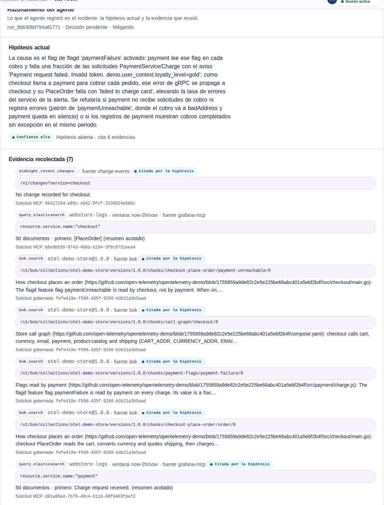

# Issue #718: the store topology in real investigations

Local OpenTelemetry Demo 3.0.0 (`scripts/demo_env.py up`, `product-catalog` and `checkout` raised to
64 MiB with `docker update` as in #765), Grafana MCP, the governed API from branch
`t3/718-2-bok-topology-e2e` set up with `scripts/setup_sre.py` (paid model `z-ai/glm-5.3-flash`),
2026-10-31. `paymentFailure` was set to `100%` in `.demo-state/flagd/demo.flagd.json` and flagd
restarted at 07:23:54Z; checkout and payment recorded error calls two minutes later. The incident
was declared from main's live checkout alert with a neutral context, `checkout error rate above
threshold`, which names neither payment nor a flag.

| Run | Prompt | BoK search | Outcome |
| --- | --- | --- | --- |
| `run_27320a03d6e06cc0` | before the keyword hint | `checkout PlaceOrder dependencies (cart, currency, payment, kafka) failure causes and error propagation`: no results | `upstream_unavailable`: the fourth model call took 80.6 s, the investigator waited 75 s |
| `run_9bb306d794a81771` (human retry, timeout 120 s) | with the keyword hint | `checkout payment`: 4 fragments | hypothesis and mitigation, awaiting approval |

The first run's search found nothing because every query word must appear in one fragment
(`kafka` is in none); the prompt now says so. The retry's hypothesis names the flag, the
mechanism and what would refute it:

> La causa es el flag de flagd 'paymentFailure' activado: payment lee ese flag en cada cobro y
> falla una fracción de las solicitudes PaymentService/Charge [...]; como checkout llama a payment
> para cobrar cada pedido, ese error de gRPC se propaga a checkout y su PlaceOrder falla con
> 'failed to charge card' [...]. Se refutaría si payment no recibe solicitudes de cobro ni registra
> errores (patrón de 'paymentUnreachable' [...]).

It cites payment's logs from OpenSearch (`resource.service.name:"payment"`, which hold `Payment
request failed. Invalid token`), the checkout change history and four `otel-demo-store@1.0.0`
fragments. The mitigation sets `paymentFailure` back to off "sin necesidad de reiniciar los
servicios payment ni checkout". On 2026-10-30, without the collection, the same failure's checkout
investigation proposed restarting payment.

Limits: two real runs, one scenario, one incident (the second run is a retry of the first, which
recorded nothing). Main has no per-service intake yet (#765), so no payment incident was opened.

